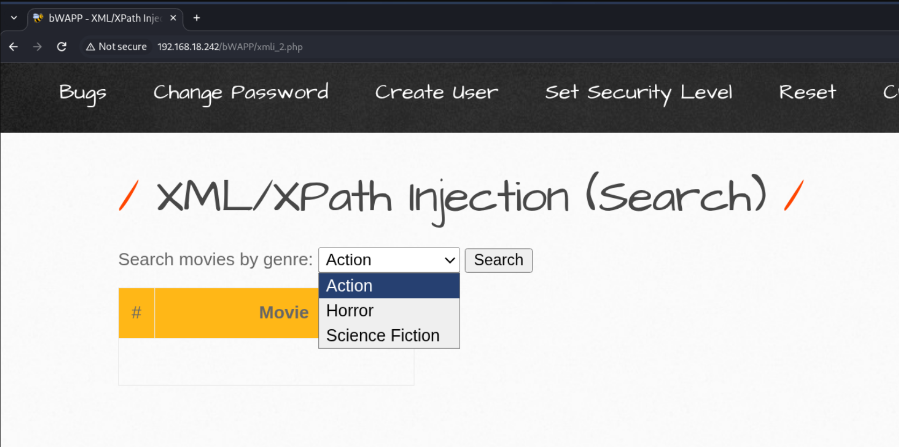
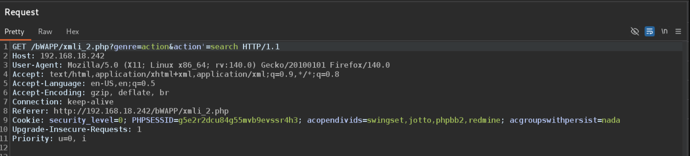
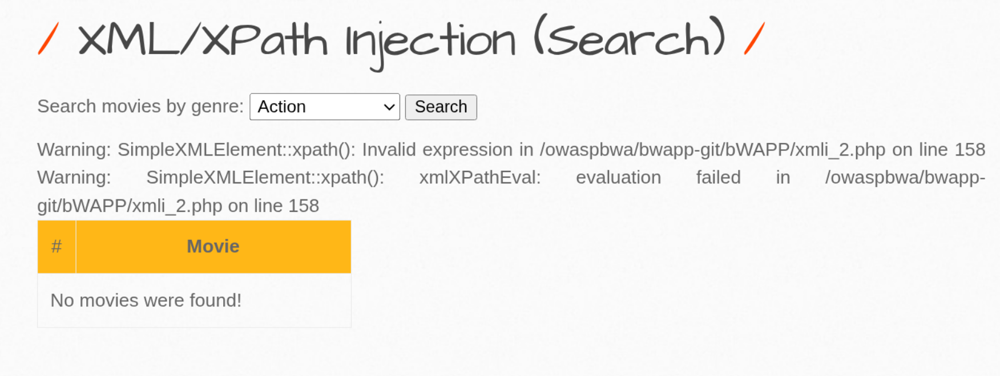
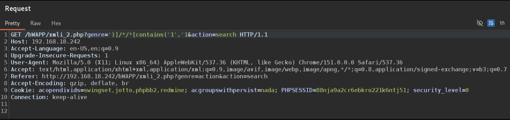
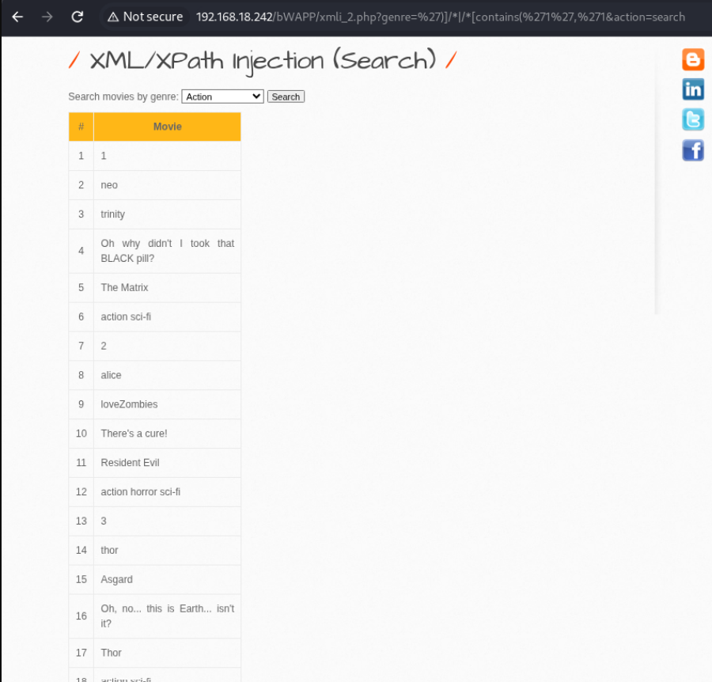

# XML

XML (Extensible Markup Language) is structurally similar to HTML, but their purposes differ: while HTML uses predefined tags to render pages, XML allows you to define custom tags to store and transport data in a hierarchical, tree-like structure. XML prioritizes data portability and human readability over raw processing speed.

**Example:**

```xml
<?xml version="1.0" encoding="UTF-8"?>
<bookstore>
  <book category="fiction">
    <title>The Great Adventure</title>
    <author>Jane Doe</author>
    <year>2023</year>
    <price>29.99</price>
  </book>
</bookstore>
```

---

## XPath Injection

XPath Injection is similar to SQL injection — the input field is not properly sanitized, allowing XPath queries to pass through. Here, XPath directly points to nodes in the XML structure to retrieve specific data.

---

## What is XPath?

XPath is a query language used to navigate and select nodes in an XML document. It works like a path system — you describe the location of the data you want, and XPath retrieves it.

For example, in the XML above:
```
/bookstore/book/title
```
This means: start at the root, go to bookstore, then book, then return the title.

XPath can also filter by conditions:
```
/bookstore/book[price>20]/title
```
Returns titles of books costing more than 20.

---

## How XPath Injection Works

When a web application uses XPath to query XML data (for example, during login), the input is often concatenated directly into the query.

**Normal query:**
```
//user[username='INPUT' and password='INPUT']
```
**Injection:**
```
' or '1'='1
```
**Resulting query:**
```
//user[username='' or '1'='1' and password='']
```
Since '1'='1' is always true, the condition bypasses authentication — same concept as SQL injection, just targeting XML instead of a database.

---

# XPath Injection — Practical

## Target
bWAPP (bug / bee)
**Lab:** XML/XPath Injection (Search)

---

## Setup

As you can see, there is no input field on this page. Instead, we have options to select a movie genre.

To exploit this, we need to intercept the request in Burpsuite and modify it with our payload.

<details>
  <summary>📸 Click to view</summary>
  <br>
  
</details>

---

## Step 1: Test for Vulnerability

Turn intercept ON and capture the request in Burpsuite.

<details>
  <summary>📸 Click to view</summary>
  <br>
  
</details>

Here we see:

genre = action

First, let's try putting a single quote and forwarding the request. If it returns an error, we know it's vulnerable to XPath injection.

**Result:** We received an error — confirming the application is vulnerable.

<details>
  <summary>📸 Click to view</summary>
  <br>
  
</details>

---

## Step 2: Understand the Query

Let's try passing only the word `act` to see if it returns the list of action genre movies.

If it does, we can guess it's using the `contains()` function.

**Result:** It worked and showed the action genre list.

So the backend query is likely:
```
[contains(genre, '$genre_input')]
```
This function checks if `genre_input` is contained in the genre name. If yes, it loads that genre.

---

## Step 3: Craft the Payload

We need to:
1. Close the existing function first
2. Then inject our own `contains()` function

**Payload:**
```
')]/*|/*[contains('1', '1
```
Paste this in the `genre` parameter (replacing `action`).

<details>
  <summary>📸 Click to view</summary>
  <br>
  
</details>

<details>
  <summary>📸 Result</summary>
  <br>
  
</details>

---

## Result

The application dumped the entire genre list on a single page — which it should never do.

Authentication and filtering were bypassed, and the XPath query was manipulated to return all data.

---

## Key Takeaways

- No visible input field? The parameter is still there in the request — intercept and modify it
- A single quote returning an error = the input isn't sanitized
- `contains()` is a common XPath function — guess it by testing partial input
- To inject, close the existing function first, then add your own logic
- XPath injection follows the same principle as SQL injection — just targeting XML instead of a database
- `')]/*|/*[contains('1', '1` — closes the original contains(), then ORs the result with the entire XML tree
